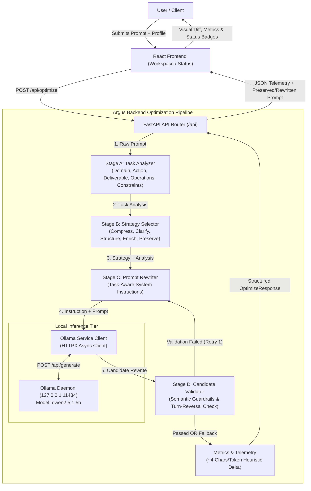
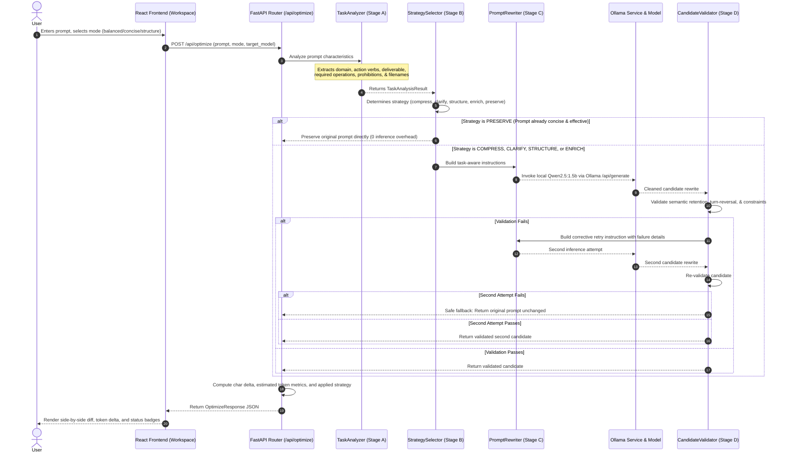

# Argus System Architecture

## 1. System Overview

**Argus** is an intelligent, task-aware prompt optimization middleware application. Its primary objective is to optimize, structure, and compress prompts locally using a compact neural model (**Qwen2.5-1.5B-Instruct** running via **Ollama**) before prompts are dispatched to downstream Large Language Models.

Argus ensures that explicit user constraints, required functional operations, prohibitions, filenames, and domain intents are strictly preserved while eliminating conversational filler, circular redundancy, and ambiguity.

---

## 2. Architectural Boundaries

Argus enforces strict separation of concerns across presentation, routing, orchestration, and inference:

1. **Frontend Isolation (`frontend/src/`)**:
   - The React application operates solely as a presentation, configuration, and monitoring interface.
   - **No prompt optimization logic, token estimation heuristics, or local model calling resides in frontend code.**
   - All backend interactions occur through strongly-typed API service contracts in [`src/services/api.ts`](file:///d:/Argus/frontend/src/services/api.ts).
   - An offline fallback mock service [`src/services/mockOptimizer.ts`](file:///d:/Argus/frontend/src/services/mockOptimizer.ts) allows UI development without a running backend.

2. **Backend Domain Isolation (`backend/app/`)**:
   - **`api/`**: HTTP route handlers, request parsing, status codes, and endpoint mapping. No raw business logic.
   - **`schemas/`**: Pydantic models declaring strict request, response, and diagnostic contracts.
   - **`services/`**: Modular domain logic for task analysis, strategy selection, prompt rewriting, candidate validation, and Ollama communication.
   - **`core/`**: Centralized application configuration ([`config.py`](file:///d:/Argus/backend/app/core/config.py)), environment loading, and server lifespan events.

3. **Inference Tier Isolation**:
   - Local neural optimization is handled exclusively by **Ollama** running `qwen2.5:1.5b` over local HTTP (`http://127.0.0.1:11434`).
   - The application does not require any paid external cloud API keys for prompt optimization.

---

## 3. End-to-End Request Flow

The complete execution lifecycle for a prompt optimization request follows a deterministic 8-step pipeline:

### Detailed Pipeline Stages:

1. **User Submission**: The user inputs raw prompt text and selects an optimization profile (`balanced`, `concise`, or `structure`) in the React Workspace.
2. **FastAPI Ingestion**: The `/api/optimize` endpoint validates the payload using Pydantic's `OptimizeRequest`. Empty or whitespace-only inputs are rejected with a structured `422 Unprocessable Content` response.
3. **Stage A — Task Analysis (`TaskAnalyzer`)**: Deterministically extracts the task category, primary action verb, primary deliverable, required operations, explicit constraints, prohibitions, and quality signals.
4. **Stage B — Strategy Selection (`StrategySelector`)**: Selects an optimization strategy based on the prompt's intrinsic characteristics and the user's selected mode. If a prompt is already effective and concise, it immediately assigns `preserve`.
5. **Stage C — Prompt Rewriting (`PromptRewriter`)**: Formulates system instructions that direct `qwen2.5:1.5b` to optimize the prompt while strictly preserving deliverables, operations, and constraints.
6. **Local Neural Generation (`OllamaService`)**: Asynchronously calls Ollama's `/api/generate` endpoint with low temperature (`0.2`) and top-p (`0.9`) to produce a predictable candidate rewrite.
7. **Stage D — Candidate Validation (`CandidateValidator`)**: Inspects the generated candidate against semantic preservation guardrails, turn-reversal patterns, prohibition retention, and hallucination checks. Retries once with corrective guidance if needed, or falls back safely to the original prompt.
8. **Telemetry & Presentation**: The backend calculates character and token metrics (~4 chars/token heuristic), determines the honest applied strategy, and returns the response to the frontend for side-by-side diff display.

---

## 4. Backend Services and Responsibilities

| Service | File Path | Primary Responsibilities |
| :--- | :--- | :--- |
| **`TaskAnalyzer`** | [`backend/app/services/task_analyzer.py`](file:///d:/Argus/backend/app/services/task_analyzer.py) | **Deterministic Prompt Inspection (Stage A)**: • Detects task domain (`coding`, `data_analysis`, `writing`, `extraction`, `summarization`, `research`, `planning`, `general`). • Extracts primary action verb (e.g., `build`, `write`, `explain`) and deliverable (e.g., `script`, `function`, `plan`). • Segments and normalizes multi-clause required functional operations (e.g., *reads sales.csv*, *calculates average*, *saves to report.csv*). • Identifies explicit constraints, negative prohibitions (`do not use pandas`), filenames, and requested schemas. • Evaluates quality signals (redundancy, underspecification, conversational filler). |
| **`StrategySelector`** | [`backend/app/services/strategy_selector.py`](file:///d:/Argus/backend/app/services/strategy_selector.py) | **Optimization Strategy Assignment (Stage B)**: • Grounded primarily in prompt characteristics. • Assigns `preserve` if the prompt is already concise and effective. • Assigns `clarify` if the prompt is underspecified or vague. • Assigns `compress` if the prompt contains circular redundancy or conversational pleasantries. • Assigns `structure` if the prompt contains multi-step operations or complex constraints. • Modulates output style according to user profiles (`balanced`, `concise`, `structure`). |
| **`PromptRewriter`** | [`backend/app/services/prompt_rewriter.py`](file:///d:/Argus/backend/app/services/prompt_rewriter.py) | **Instruction Engineering (Stage C)**: • Builds task-aware system instructions for `qwen2.5:1.5b`. • Enforces deliverable preservation (instructing the model to write code if software was requested). • Prohibits interactive turn reversals (preventing the model from asking the user for data). • Generates targeted corrective instructions during validation retry attempts. |
| **`CandidateValidator`** | [`backend/app/services/candidate_validator.py`](file:///d:/Argus/backend/app/services/candidate_validator.py) | **Deterministic Verification Guardrails (Stage D)**: • Verifies primary action verb and deliverable preservation. • Detects interactive turn-reversals (`"Please provide the data..."`). • Checks retention of required functional operations and concepts. • Verifies negative constraints (`never`, `do not use`) are not inverted or dropped. • Guarantees filenames, numbers, and technical identifiers are preserved. • Detects meta-instruction leakage and unrequested format hallucinations. |
| **`OllamaService`** | [`backend/app/services/ollama_service.py`](file:///d:/Argus/backend/app/services/ollama_service.py) | **Pipeline Orchestration & Model Communication**: • Coordinates Stages A through D. • Manages async HTTP calls to Ollama (`/api/generate` and `/api/tags`). • Cleans model output (strips markdown fences, introductory chatter, and quoted wraps). • Executes corrective retries and handles safe fallback to original prompts. • Computes character deltas and heuristic token estimations. |
| **`HealthService`** | [`backend/app/services/health_service.py`](file:///d:/Argus/backend/app/services/health_service.py) | **System Health Inspection**: • Returns operational status (`ok`), application version, environment, and ISO UTC timestamp for heartbeat monitoring. |

---

## 5. Token Estimation & Honest Metrics Standard

### Heuristic Character-Based Token Counting
Argus calculates estimated token counts using a standardized character-to-token heuristic:

$$\text{estimated\_tokens} = \max\left(1, \left\lceil \frac{\text{len}(\text{trimmed\_text})}{\text{CHARS\_PER\_TOKEN\_HEURISTIC}} \right\rceil\right)$$

where `CHARS_PER_TOKEN_HEURISTIC` defaults to `4.0` in configuration.

> [!NOTE]
> Character-based token counts are fast, local approximations designed to illustrate relative changes in prompt footprint. They are **estimates** and do not represent exact Byte-Pair Encoding (BPE) or WordPiece tokenizer counts.

### Honest Reporting Standards:
1. **Character Delta**: Defined consistently as `len(optimized_prompt) - len(original_prompt)`.
   - **Negative value**: The prompt was compressed (shorter).
   - **Positive value**: The prompt was expanded (longer) to add necessary clarity or deliverable definitions.
   - **Zero**: The prompt remained unchanged.
2. **Token Savings**:
   - Reported as `max(0, original_tokens - optimized_tokens)`.
   - When a prompt legitimately expands to resolve ambiguity, token savings are reported as `0`, never as a negative number or fabricated savings.
3. **Applied Strategy vs. Requested Profile**:
   - If the user selects `structure` mode but the model rewrite produces flat text or falls back to the original prompt, the backend honestly reports `compress` or `preserve`, never falsely claiming structural formatting.

---

## 6. Security and Configuration Management

- **Zero Hardcoded Secrets**: Configuration is managed via Pydantic `BaseSettings` reading from environment variables and `.env` files.
- **Local Network Isolation**: The optimization pipeline operates entirely within the host machine (`127.0.0.1`), ensuring zero external data leakage during prompt rewriting.
- **CORS Protection**: FastAPI middleware restricts cross-origin browser requests strictly to configured origins (`http://localhost:5173`, `http://127.0.0.1:5173`).
- **Input Validation**: Rigorous Pydantic schema validation rejects malformed payloads and empty prompts.

---

## 7. Phase-by-Phase Roadmap

| Phase | Milestone | Scope & Deliverables | Status |
| :---: | :--- | :--- | :---: |
| **Phase 1** | **Repository Foundation & Project Organization** | Scaffolding, design tokens, FastAPI foundation, health endpoint, React 19 + Tailwind CSS v4, Vitest, CI workflow. | ✅ Complete |
| **Phase 2** | **UI/UX Workspace & System Status** | Responsive workspace, prompt editor, profile selection, side-by-side comparison view, metrics panel, System Status page. | ✅ Complete |
| **Phase 3** | **Real Local LLM Integration** | Ollama HTTP integration (`http://127.0.0.1:11434`), `qwen2.5:1.5b` model communication, error handling, status monitoring. | ✅ Complete |
| **Phase 3.1** | **Task-Aware Optimization Engine** | Modular pipeline (Stages A–D), task domain classification, strategy selection (`compress`, `clarify`, `structure`, `enrich`, `preserve`), explicit constraint & prohibition guardrails, candidate validation. | ✅ Complete |
| **Phase 3.2** | **Semantic Preservation & Zero-Hardcoding** | Action/deliverable intent extraction, anti-turn-reversal validation, corrective retry/fallback, generalized taxonomies, centralized configuration. | ✅ Complete |
| **Phase 3.2.1** | **Required-Operation Preservation Engine** | Multi-clause operation extraction, computation/transformation preservation validation, concept synonym mapping, retry/fallback integration. | ✅ Complete |
| **Phase 3.2.2** | **Strategy Accuracy, Minimal Rewriting & Honest Metrics** | Profile refinement, unsupported addition prevention, accurate applied strategy metadata, consistent character delta (`final - original`), honest status badges. | ✅ Complete |
| **Phase 4** | **Frontier LLM Gateway & Provider Dispatch** | Configurable external provider integration (Google Gemini / OpenAI), optional direct downstream execution, and frontier token metrics. | ⏳ Planned |
| **Phase 5** | **Optimization Telemetry & Benchmarking** | Reproducible prompt evaluation datasets, automated constraint verification, quality scoring, and optimization analytics. | ⏳ Planned |
| **Phase 6** | **Cloud Deployment & Production Hardening** | Dockerization, Azure Container Apps / AWS ECS deployment, observability, and containerized Ollama sidecars. | ⏳ Planned |

---

## 8. Technology Stack Reference

- **Frontend**: React 19, TypeScript, Vite, Tailwind CSS v4, Lucide Icons, Vitest, Testing Library.
- **Backend**: Python 3.10–3.13, FastAPI, Pydantic v2, Pydantic-Settings, Uvicorn, HTTPX, Pytest, AnyIO.
- **Local Inference**: Ollama with `qwen2.5:1.5b`.
- **Target Deployment**: Docker, Azure Container Apps / AWS ECS.
