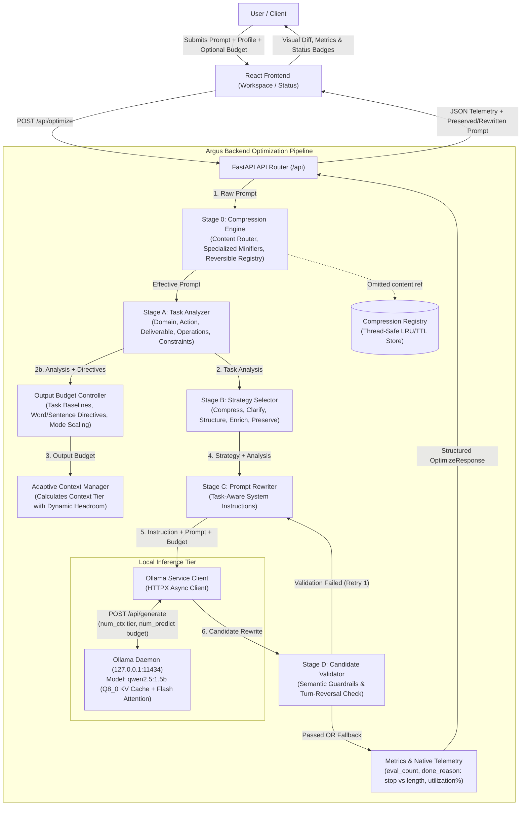
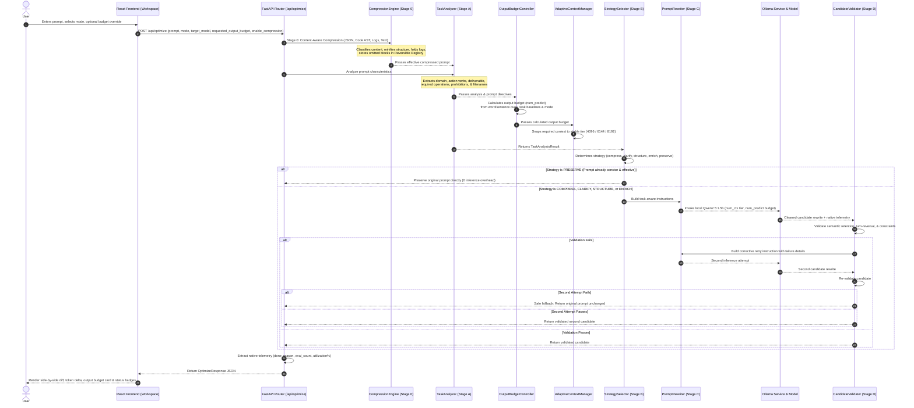

# Argus System Architecture

## 1. System Overview

**Argus** is an intelligent, task-aware prompt optimization middleware application. Its primary objective is to optimize, structure, and compress prompts locally using a compact neural model (**Qwen2.5-1.5B-Instruct** running via **Ollama**) before prompts are dispatched to downstream Large Language Models.

Argus ensures that explicit user constraints, required functional operations, prohibitions, filenames, and domain intents are strictly preserved while eliminating conversational filler, circular redundancy, and ambiguity.

---

## 2. Architectural Boundaries

Argus enforces strict separation of concerns across presentation, routing, orchestration, and inference:

1. **Frontend Isolation (`frontend/src/`)**:
   - The React application operates solely as a presentation, configuration, and monitoring interface.
   - **No prompt optimization logic, token estimation heuristics, or local model calling resides in frontend code.**
   - All backend interactions occur through strongly-typed API service contracts in [`src/services/api.ts`](file:///d:/Argus/frontend/src/services/api.ts).
   - An offline fallback mock service [`src/services/mockOptimizer.ts`](file:///d:/Argus/frontend/src/services/mockOptimizer.ts) allows UI development without a running backend.

2. **Backend Domain Isolation (`backend/app/`)**:
   - **`api/`**: HTTP route handlers, request parsing, status codes, and endpoint mapping. No raw business logic.
   - **`schemas/`**: Pydantic models declaring strict request, response, diagnostic, and telemetry contracts.
   - **`services/`**: Modular domain logic for task analysis, strategy selection, output budget control, prompt rewriting, candidate validation, adaptive context tier calculation, and Ollama communication.
   - **`core/`**: Centralized application configuration ([`config.py`](file:///d:/Argus/backend/app/core/config.py)), environment loading, and server lifespan events.

3. **Inference Tier Isolation**:
   - Local neural optimization is handled exclusively by **Ollama** running `qwen2.5:1.5b` over local HTTP (`http://127.0.0.1:11434`).
   - The application does not require any paid external cloud API keys for prompt optimization.

---

## 3. End-to-End Request Flow

The complete execution lifecycle for a prompt optimization request follows a deterministic 9-step pipeline:

---

## 4. Backend Services and Responsibilities

| Service | File Path | Primary Responsibilities |
| :--- | :--- | :--- |
| **`TaskAnalyzer`** | [`backend/app/services/task_analyzer.py`](file:///d:/Argus/backend/app/services/task_analyzer.py) | **Deterministic Prompt Inspection (Stage A)**: • Detects task domain (`coding`, `data_analysis`, `writing`, `extraction`, `summarization`, `research`, `planning`, `general`). • Extracts primary action verb (e.g., `build`, `write`, `explain`) and deliverable (e.g., `script`, `function`, `plan`). • Segments and normalizes multi-clause required functional operations. • Identifies explicit constraints, negative prohibitions (`do not use pandas`), filenames, and requested schemas. • Evaluates quality signals (redundancy, underspecification, conversational filler). |
| **`OutputBudgetController`** | [`backend/app/services/output_budget_controller.py`](file:///d:/Argus/backend/app/services/output_budget_controller.py) | **Output Budget Allocation (Phase 4.1)**: • Computes dynamic generation token ceilings (`num_predict`). • Extracts explicit length directives via regex (word counts, sentence counts, paragraph counts, brevity cues). • Maps task baselines scaled by optimization mode (`concise`: 0.75x, `balanced`: 1.0x, `structure`: 1.2x) and complexity (+20%). • Enforces global bounds `[OUTPUT_BUDGET_MIN_TOKENS, OUTPUT_BUDGET_MAX_TOKENS]`. • Coordinates with context window headroom and rejects with HTTP 413 if headroom < 64 tokens. |
| **`AdaptiveContextManager`** | [`backend/app/services/adaptive_context_manager.py`](file:///d:/Argus/backend/app/services/adaptive_context_manager.py) | **Context-Length & Tier Derivation**: • Calculates total context footprint: $\text{System} + \text{Wrapper} + \text{Input} + \text{Output Budget} + \text{Headroom}$. • Derives eligible tiers bounded by `OLLAMA_MAX_NUM_CTX` (e.g. 4096, 6144, 8192). • Snaps requests to stable tiers to preserve KV-cache prefix reuse. • Enforces low-VRAM safeguards (<1000 MiB free) and rejects overflow with HTTP 413. |
| **`StrategySelector`** | [`backend/app/services/strategy_selector.py`](file:///d:/Argus/backend/app/services/strategy_selector.py) | **Optimization Strategy Assignment (Stage B)**: • Assigns `preserve` if prompt is already concise and actionable. • Assigns `clarify` if prompt is underspecified or vague. • Assigns `compress` if prompt contains circular redundancy or conversational filler. • Assigns `structure` if prompt contains multi-step operations or complex constraints. |
| **`PromptRewriter`** | [`backend/app/services/prompt_rewriter.py`](file:///d:/Argus/backend/app/services/prompt_rewriter.py) | **Instruction Engineering (Stage C)**: • Builds task-aware system instructions for `qwen2.5:1.5b`. • Enforces deliverable preservation. • Prohibits interactive turn reversals. • Generates targeted corrective instructions during validation retry attempts. |
| **`CandidateValidator`** | [`backend/app/services/candidate_validator.py`](file:///d:/Argus/backend/app/services/candidate_validator.py) | **Deterministic Verification Guardrails (Stage D)**: • Verifies primary action verb and deliverable preservation. • Detects interactive turn-reversals (`"Please provide the data..."`). • Checks retention of required functional operations and concepts. • Verifies negative constraints are not inverted or dropped. • Guarantees filenames, numbers, and technical identifiers are preserved. |
| **`ConcurrencyController`** | [`backend/app/services/concurrency_controller.py`](file:///d:/Argus/backend/app/services/concurrency_controller.py) | **Runtime Hardware-Aware Admission**: • Condition-based admission gate (`asyncio.Condition`). • Dynamically throttles capacity from 3 down to 1 under constrained VRAM (<400 MiB) or RAM (<1024 MiB). • Rejects requests with HTTP 503 if VRAM <150 MiB or RAM <512 MiB. • Tracks queue depth and wait latencies. |
| **`LocalModelRegistry`** | [`backend/app/services/routing/registry.py`](file:///d:/Argus/backend/app/services/routing/registry.py) | **Dynamic Model Discovery & Inspection**: • Queries `/api/tags`, `/api/ps`, and `/api/show` with TTL caching. • Extracts parameter counts, quantization levels, model families, and context bounds without hardcoding. • Identifies active resident models and live memory usage. |
| **`ModelRouter`** | [`backend/app/services/routing/router.py`](file:///d:/Argus/backend/app/services/routing/router.py) | **Heuristic Complexity & Hardware-Aware Routing**: • Evaluates multi-dimensional prompt signals into an explainable heuristic score in [0.0, 1.0]. • Assesses live GPU VRAM and host RAM against candidate requirements with safety margins. • Evaluates evictable idle memory when concurrency in flight is 0. • Dynamically selects optimal optimizer model (small vs medium) or executes graceful resource fallback. • Respects manual model overrides. |
| **`OllamaService`** | [`backend/app/services/ollama_service.py`](file:///d:/Argus/backend/app/services/ollama_service.py) | **Pipeline Orchestration & Model Communication**: • Coordinates Stages A through D and Output Budget Control. • Manages async HTTP calls to Ollama (`/api/generate` and `/api/tags`). • Extracts native telemetry (`prompt_eval_count`, `prompt_eval_cached_count`, `eval_count`, `done_reason`, `generation_tokens_per_second`). • Executes corrective retries and handles safe fallback to original prompts. |

---

## 5. Token Estimation & Honest Metrics Standard

### Heuristic Character-Based Token Counting
Argus calculates estimated token counts using a standardized character-to-token heuristic:

$$\text{estimated\_tokens} = \max\left(1, \left\lceil \frac{\text{len}(\text{trimmed\_text})}{\text{CHARS\_PER\_TOKEN\_HEURISTIC}} \right\rceil\right)$$

where `CHARS_PER_TOKEN_HEURISTIC` defaults to `4.0` in configuration.

### Output Budget & Native Ollama Telemetry (Phase 4.1)
Argus captures native runtime measurements directly from Ollama without simulation:
1. **`num_predict_limit`**: The allocated generation token ceiling.
2. **`eval_count`**: The exact number of tokens generated by the model.
3. **`done_reason`**: 
   - `"stop"`: The model finished generating naturally via EOS token.
   - `"length"`: Generation halted because it reached the `num_predict` ceiling.
4. **`budget_utilization_percent`**: $\frac{\text{eval\_count}}{\text{allocated\_budget}} \times 100\%$.
5. **`hit_budget_limit`**: True if generation was truncated by the budget limit.
6. **Zero-Fabrication Standard**: If Ollama or test mocks do not provide native metrics, fields remain `null`.

---

## 6. Local-First Model Routing Engine (Phase 5)

### Architectural Scope and Core Principle
Argus Phase 5 introduces an intelligent, local-first **Optimizer Model Routing Engine**. Large local models (e.g. 7B parameters) deliver higher reasoning fidelity and nuanced structure preservation for complex multi-clause instructions, but incur significantly higher VRAM footprints and generation latencies. Compact models (e.g. 1.5B parameters) achieve high throughput and low memory footprints, making them ideal for routine compression tasks.

The Phase 5 routing engine automatically selects the optimal local Ollama model to rewrite/optimize the prompt, based on:
1. **Explainable Heuristic Complexity Scoring**: Multi-signal algorithmic evaluation without black-box routing networks.
2. **Observable Live Hardware Telemetry**: Real-time evaluation of NVIDIA GPU VRAM (`nvidia-smi`), system RAM, and active Ollama model residency.
3. **Strict Local-First Boundary**: Argus relies 100% on local Ollama execution with zero external cloud API keys, zero cloud providers, and zero external routing frameworks.

> [!IMPORTANT]
> **Optimizer Routing vs Downstream Routing Boundary**:
> Phase 5 implements **Optimizer Model Routing** (selecting the local Ollama model that optimizes the prompt). Downstream task execution routing (selecting external or local models for executing the optimized prompt against real end-user workloads) is **explicitly deferred** to subsequent phases.

### Routing Decision Algorithm
1. **Explainable Heuristic Complexity Assessment**:
   $$\text{Score} = w_{\text{category}} + \min(0.30, 0.075 \cdot N_{\text{constraints}}) + \min(0.25, 0.06 \cdot N_{\text{ops}}) + 0.10 \cdot \mathbf{1}_{\text{prohibitions}} + 0.10 \cdot \mathbf{1}_{\text{code/data}} + w_{\text{tokens}} + w_{\text{mode}}$$
   - Score is clamped to $[0.0, 1.0]$.
   - Tasks with $\text{Score} \ge \text{threshold}$ (default `0.55`) target `ModelTier.MEDIUM` (discovered high-capacity candidate).
   - Tasks with $\text{Score} < \text{threshold}$ target `ModelTier.SMALL` (discovered lightweight candidate).

2. **Neutral Model Ranking Policy**:
   Candidate selection within target tiers is strictly vendor-neutral and family-agnostic. All substring checks (such as `"qwen"`) are prohibited. Selection is determined deterministically using verified metadata:
   - **Resident Model Priority**: Models already resident in GPU VRAM (`is_loaded=True`) are prioritized first to avoid loading latency, cold-start latency spikes, and transient VRAM churn.
   - **Tier-Specific Parameter Optimization**:
     - For `ModelTier.SMALL`: Models with lower verified parameter counts are sorted first to maximize throughput and minimize memory footprint.
     - For `ModelTier.MEDIUM` & `ModelTier.LARGE`: Models with higher verified parameter counts are sorted first to maximize reasoning depth and instruction-following fidelity.
   - **Quantization Precision Priority**: When parameter counts are equal, higher bit-depth quantizations (e.g., `Q8_0` > `Q4_K_M`) are prioritized for superior precision.
   - **Deterministic Alphabetical Tie-Breaking**: Any ties are broken by case-insensitive lexicographical sorting of the model name (`model.name.lower()`), ensuring 100% reproducible decisions across runs.

3. **Heuristic Margin Terminology**:
   - $\text{heuristic\_margin} = |\text{Score} - \text{threshold}|$.
   - **Important Terminology Standard**: Argus explicitly defines `heuristic_margin` as an *uncalibrated heuristic distance* between prompt complexity and the tier boundary. It is **not** a calibrated probability, bayesian confidence, or model certainty metric.

4. **Hardware Feasibility Gate & Memory Footprint Distinction**:
   Argus maintains strict distinction between different memory metrics to prevent misleading telemetry:
   - **Measured Resident VRAM (`measured_resident`)**: Extracted directly from Ollama `/api/ps` (`size_vram`). Only reported when the model is actively resident in GPU memory.
   - **Disk Weight Footprint (`weight_footprint_mb`)**: Physical size of the model weights on disk (`size_bytes / (1024 * 1024)`). This is never reported as measured resident VRAM.
   - **Architecture-Derived Runtime Proxy (`architecture_proxy`)**: When model architecture metadata ($L$ layers, $H_{\text{kv}}$ heads, $D_{\text{head}}$ dimension) is available from `/api/show`, computes KV cache requirement from actual architecture dimensions scaled by context window and configured KV cache precision (`OLLAMA_KV_CACHE_TYPE`, e.g. Q8_0):
     $$\text{KV Bytes} = 2 \times L \times (H_{\text{kv}} \cdot D_{\text{head}}) \times \text{context\_tokens} \times \text{bytes\_per\_elem}$$
   - **Rough Proxy (`rough_proxy`)**: When detailed architecture metadata is absent, uses a clearly identified, conservative tier-based heuristic buffer scaled to context length ($ctx / 4096 \times \text{buffer}$). Stricter deployments can reject rough proxies via `ROUTING_REQUIRE_ARCHITECTURE_METADATA=True`.
   - **CPU-Only Execution (`cpu_only`)**: For systems without GPU acceleration or where GPU telemetry is unavailable, Argus supports CPU-only Ollama execution guarded by `ROUTING_ALLOW_CPU_EXECUTION` (default: `True`). In CPU mode, required memory is evaluated with complete architectural rigor:
     $$\text{Estimated Required RAM} = \text{Model Weights} + \text{Estimated KV-Cache} + \text{CPU Runtime Scratchpad Allowance} + \text{Host RAM Safety Margin}$$
     - **Centralized Pydantic Settings**: CPU runtime allowances are environment-configurable with non-negative integer validation:
       - `ROUTING_CPU_ALLOWANCE_SMALL_MB`: 64 MiB default for small-tier models.
       - `ROUTING_CPU_ALLOWANCE_MEDIUM_MB`: 128 MiB default for medium-tier models.
       - `ROUTING_CPU_ALLOWANCE_LARGE_MB`: 256 MiB default for large-tier models.
       - `ROUTING_CPU_ALLOWANCE_DEFAULT_MB`: 128 MiB default fallback for unknown tiers.
     - **Loaded vs Unloaded Diagnostic Distinction**: If the model is already loaded (`is_loaded=True`), Ollama already holds the weights resident in RAM, so the admission check evaluates runtime headroom ($\text{KV} + \text{allowance} + \text{margin}$) while clearly indicating resident weights in diagnostics. For unloaded models, the full weight footprint is included in admission calculations.
   - **Unavailable Telemetry Rejection (`unverified`)**: If host RAM telemetry is unavailable, or if model size metadata is missing (`size_bytes <= 0`), resource safety cannot be established. Such requests are rejected conservatively to protect system stability.
   - **Resident Headroom**: If candidate model is already resident in GPU VRAM, checks runtime headroom ($\text{VRAM}_{\text{free}} \ge \text{ROUTING\_LOADED\_HEADROOM\_MARGIN\_MB}$, default 250 MiB).
   - **Load Headroom**: If candidate model is not currently resident, evaluates load headroom against estimated runtime requirement plus safety margin ($\text{VRAM}_{\text{available}} \ge \text{Estimated Runtime VRAM} + \text{ROUTING\_VRAM\_SAFETY\_MARGIN\_MB}$, default 512 MiB; capped at 128 MiB for small-tier models).
   - **Host RAM Protection**: Requires $\text{RAM}_{\text{free}} \ge \text{ROUTING\_RAM\_SAFETY\_MARGIN\_MB}$ (default 1024 MiB; 512 MiB for small-tier models).

5. **Model Registry Classification & Zero-Guessing Policy**:
   - `LocalModelRegistry` queries `/api/tags`, `/api/ps`, and deep `/api/show` metadata.
   - **Zero Name Guessing**: Substring matching on model names is forbidden. Tiers are assigned strictly from verified parameter metadata (`parameter_count` or `/api/show` `details.parameter_size`).
   - Models without verifiable parameter counts are classified as `ModelTier.UNKNOWN`.
   - Unknown-tier models are never assumed small or safe. Admission is strictly guarded by `ROUTING_ALLOW_UNKNOWN_TIER` (default: `False`).

6. **Manual Override Safety & Rejection Standards**:
   - Manual overrides never silently bypass memory or resource checks.
   - If a requested override model cannot fit safely in memory, Argus rejects the request with a structured `ModelResourceConstraintError` (HTTP 400).
   - Override fallback is only permitted if explicitly authorized by the caller via `allow_override_fallback=True` (or `ROUTING_ALLOW_OVERRIDE_FALLBACK=True`).

7. **Verified Fallback Standards**:
   - Fallback models must be verified as installed in the local Ollama catalog and verified to have sufficient memory.
   - Fallback candidates are ranked using the same deterministic, neutral ranking policy.
   - Configured defaults are never assumed installed.
   - If no verified safe installed fallback exists, `NoSafeFallbackError` is raised with a clear error payload.

8. **Validation & Benchmarking Protocol**:
   - Live validation differentiates between **Scenario 3A: Policy Simulations** (artificially strict policy thresholds such as high safety margins to verify that fallback triggers when policies require it) and **Scenario 3B: Natural Hardware Resource Observations** (accurate reporting of physical hardware state without artificial exhaustion or crash risks).
   - In Scenario 3B: If physical hardware has sufficient headroom, the benchmark accurately reports `natural_fallback_triggered: false` and status `VERIFIED (NATURAL_HEADROOM_SUFFICIENT_NO_FALLBACK)`. Argus never fabricates or claims natural fallback when `is_fallback=false`.

---

## 7. End-to-End Downstream Output Comparison Architecture

### 7.1 Overview & Dual Execution Flow

Argus provides end-to-end downstream output comparison to evaluate real prompt token reduction and generation behavior across actual LLM completions.

Unlike prompt-only rewriting or simulated metrics, Argus executes two genuine downstream inference requests against local Ollama models:

```mermaid
sequenceDiagram
    autonumber
    actor User as User / Client
    participant API as FastAPI APIRouter (/api/compare)
    participant CompSvc as ComparisonService
    participant Reg as LocalModelRegistry
    participant OptSvc as OllamaService (Optimizer)
    participant Ollama as Ollama Daemon (/api/generate)

    User->>API: POST /api/compare {prompt, downstream_model, mode, ...}
    API->>CompSvc: compare(request)
    CompSvc->>Reg: get_model(downstream_model)
    alt Model not installed
        Reg-->>CompSvc: None
        CompSvc-->>API: raise DownstreamModelNotFoundError (HTTP 400)
        API-->>User: HTTP 400 Model Not Installed
    end
    Reg-->>CompSvc: DiscoveredModel (pinned_model)

    rect rgb(10, 20, 35)
        Note over CompSvc,Ollama: Execution A (Original Prompt)
        CompSvc->>Ollama: POST /api/generate {model: pinned_model, prompt: original_prompt}
        Ollama-->>CompSvc: raw_response_a + native telemetry (prompt_eval_count, eval_count, durations)
    end

    rect rgb(15, 30, 45)
        Note over CompSvc,OptSvc: Argus Prompt Optimization Pipeline
        CompSvc->>OptSvc: optimize_prompt(OptimizeRequest(...))
        OptSvc-->>CompSvc: OptimizeResponse (optimized_prompt, strategy, metrics)
    end

    rect rgb(10, 20, 35)
        Note over CompSvc,Ollama: Execution B (Optimized Prompt)
        CompSvc->>Ollama: POST /api/generate {model: pinned_model, prompt: optimized_prompt}
        Ollama-->>CompSvc: raw_response_b + native telemetry (prompt_eval_count, eval_count, durations)
    end

    CompSvc->>CompSvc: calculate_metrics(exec_a, exec_b)
    CompSvc-->>API: ComparisonResponse
    API-->>User: HTTP 200 {original_execution, optimized_execution, metrics, optimizer_details}
```

### 7.2 Downstream Model Pinning & Parameter Parity

- **Model Pinning**: Both Execution A and Execution B run against the exact same pinned downstream model. Independent routing to different models is forbidden to guarantee a fair comparison.
- **Model Availability Gate**: The model is validated using `LocalModelRegistry.get_model(downstream_model, force_refresh=True)`. If uninstalled, the call fails immediately with HTTP 400 (`DownstreamModelNotFoundError`). No silent fallback or model substitution is permitted.
- **Identical Generation Conditions**:
  - `temperature`: Applied identically to both calls (default: `OLLAMA_TEMPERATURE`).
  - `top_p`: Applied identically to both calls (default: `OLLAMA_TOP_P`).
  - `num_predict`: Applied identically to both calls (default: `OLLAMA_NUM_PREDICT` or user `max_tokens`).
  - `system_instruction`: If supplied, passed identically to both calls as `system`.
  - `num_ctx`: Dynamically snapped using `AdaptiveContextManager` based on prompt token demands.

### 7.3 Telemetry Capture & Honest Metrics Standards

All execution data is sourced directly from native Ollama completion responses:

| Metric | Source / Formula | Unavailable Handling |
| :--- | :--- | :--- |
| **Prompt Tokens** | `data["prompt_eval_count"]` | Returned as `null`, rendered as `N/A` |
| **Output Tokens** | `data["eval_count"]` | Returned as `null`, rendered as `N/A` |
| **Total Tokens** | `prompt_tokens + output_tokens` | Returned as `null`, rendered as `N/A` |
| **Inference Latency** | Measured wall-clock time (`time.perf_counter()`) | Returned as `null`, rendered as `N/A` |
| **Time to First Token (TTFT)** | `round(data["prompt_eval_duration"] / 1e6, 2)` ms | Returned as `null`, rendered as `N/A` |
| **Completion Reason** | `data["done_reason"]` (`"stop"` vs `"length"`) | Returned as `null`, rendered as `N/A` |
| **Prompt Token Reduction** | `round(((orig_p - opt_p) / orig_p) * 100, 2)` | If `orig_p <= 0`: `0.0`. If missing: `null` |
| **Output Token Delta** | `opt_o - orig_o` | Returned as `null`, rendered as `N/A` |
| **Total Token Delta** | `orig_t - opt_t` | Returned as `null`, rendered as `N/A` |
| **Semantic Quality** | Fixed to `"not_evaluated"` | Explanatory note: automated judge not configured |

### 7.4 Zero-Fabrication Guarantees

1. **Downstream Isolation**: The downstream model receives raw, unmanipulated prompts without prompt-engineering rewrite directives or optimizer wrapping.
2. **Distinct Output Logging**: Response A and Response B are independent LLM completions, never optimizer explanations or mock text.
3. **Partial Execution Rejection**: If Execution A, the Optimizer, or Execution B encounters an error or timeout, the entire request fails with a structured error status (HTTP 500/502/503/504). No partial or fabricated comparison is returned.
4. **Transparent Quality Labeling**: Quality is explicitly reported as `not_evaluated`. Argus never fabricates similarity scores, BLEU/ROUGE approximations, or automated judge verdicts without a configured evaluator.

