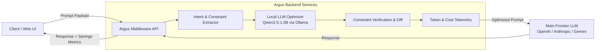
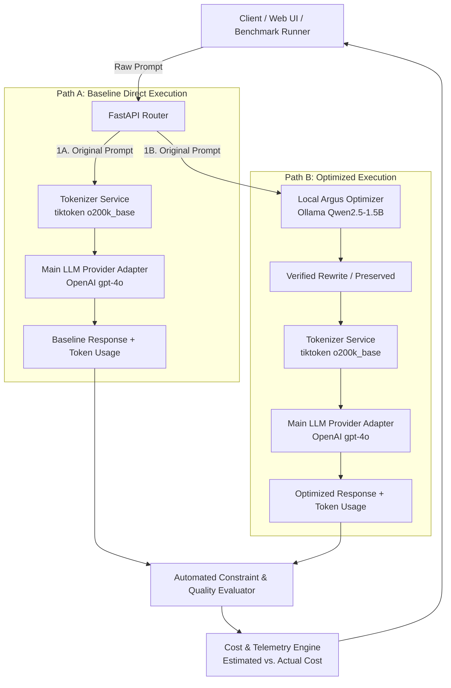

# Argus System Architecture

## 1. System Overview

Argus is an intelligent prompt optimization middleware application. Its primary objective is to dramatically decrease input-token consumption and inference costs on expensive frontier LLMs (e.g., OpenAI GPT-4o, Anthropic Claude 3.5 Sonnet, Google Gemini 1.5 Pro) without sacrificing response accuracy or constraint fidelity.

---

## 2. Architectural Boundaries

Strict architectural boundaries are maintained across the stack:

1. **Frontend Isolation**:
   - The frontend (`frontend/src/`) functions strictly as a presentation, configuration, and monitoring layer.
   - **No prompt optimization logic, tokenization mathematics, or provider API calling belongs in frontend code.**
   - All network interactions occur exclusively through typed service contracts (`frontend/src/services/api.ts`).

2. **Backend Domain Isolation**:
   - **`api/`**: Route definitions, HTTP protocol translation, status codes, and input/output schema mapping. No raw business logic.
   - **`schemas/`**: Pydantic models for strict contract validation and serialization.
   - **`services/`**: Core domain logic, orchestration, prompt compression routines, and local/frontier LLM integrations.
   - **`core/`**: Centralized configuration (`config.py`), logging, security utilities, and lifespan handlers.

3. **Inference Separation**:
   - **Local Inference Tier**: Handled by Ollama running `Qwen2.5-1.5B-Instruct` locally or in a co-located container. It executes the prompt compression heuristics.
   - **Frontier Inference Tier**: Cloud LLM providers are contacted solely by the backend via secure provider SDKs/HTTP clients using server-side environment secrets.

---

## 3. Security & Credential Management

- **Zero Client Credential Exposure**: Client-side bundles never contain provider API keys (OpenAI, Anthropic, AWS, Azure, etc.).
- **Environment Isolation**: Sensitive configuration is managed through server-side `.env` files and platform secret stores (AWS Secrets Manager, Azure Key Vault).
- **CORS Protection**: FastAPI enforces strict origin verification limiting browser requests to explicitly allowed frontend domains.
- **Git Hygiene**: Model weights (`.gguf`, `.safetensors`, `.bin`), virtual environments, build artifacts, and secret files are permanently excluded from version control via `.gitignore`.

---

## 4. Phase-by-Phase Roadmap

| Phase | Milestone | Focus Area | Status |
| :--- | :--- | :--- | :---: |
| **Phase 1** | **Repository Foundation & Project Organization** | Scaffolding, design tokens, FastAPI structure, health endpoint, CI, testing harness. | ✅ Complete |
| **Phase 2** | **Core Prompt Processing Pipeline** | Intent extraction, prompt token analysis, and compression rule framework. | ✅ Complete |
| **Phase 3** | **Local LLM Integration** | Ollama integration with `Qwen2.5-1.5B-Instruct`, local inference benchmarks. | ✅ Complete |
| **Phase 4** | **Main LLM Dispatch & Provider Adapters** | Configurable external provider adapter (OpenAI), Baseline vs. Optimized paths, reproducible benchmark suite, token & cost telemetry. | ✅ Complete |
| **Phase 5** | **Dashboard & Optimization Telemetry** | Interactive prompt playground, token savings metrics, cost estimation analytics. | ⏳ Planned |
| **Phase 6** | **Cloud Deployment & Production Hardening** | Dockerization, Azure Container Apps / AWS ECS deployment, and observability. | ⏳ Planned |

---

## 5. Phase 4 Architecture: Main-LLM Integration & Reproducible Benchmark

Phase 4 bridges Argus's local neural optimization pipeline with real external frontier LLM APIs and introduces an empirical, reproducible benchmark.

### Key Architectural Tenets of Phase 4:

1. **Provider Adapter Abstraction**:
   - `BaseLLMProvider`: Common interface defining `generate()`, `is_configured()`, and `get_status()`.
   - `OpenAIProvider`: Production-grade HTTP adapter using official OpenAI Chat Completions API with server-side environment secrets.
   - `MockLLMProvider`: Deterministic adapter for automated CI testing guaranteeing zero paid external API calls.

2. **Zero Client Credential Exposure**:
   - API keys (`OPENAI_API_KEY`) remain strictly on the backend.
   - Provider status endpoints (`GET /api/main-llm/status`) report configuration state without ever exposing credentials.

3. **Strict Cost & Token Distinction**:
   - **Provider Tokenizer Counting**: Uses official BPE encodings (`tiktoken` `o200k_base` for `gpt-4o` and `gpt-4o-mini`) rather than crude heuristic estimations when measuring prompt tokens.
   - **Estimated vs. Actual Costs**: Pre-execution estimates are explicitly tagged `is_estimated=True`; costs derived from provider-reported usage numbers are tagged `is_estimated=False`. Never conflated.

4. **Automated Quality & Safety Verification**:
   - `BenchmarkEvaluator`: Programmatically verifies that:
     - Negative constraints (e.g., `"do not use pandas"`) are respected in LLM outputs.
     - Critical entities, filenames, and output keys are strictly retained.
     - Output schemas (e.g. valid JSON parseability) are preserved.

---

## 6. Technology Stack Reference

- **Frontend**: React 19, TypeScript, Vite, Tailwind CSS v4, Lucide Icons, Vitest.
- **Backend**: Python 3.10+, FastAPI, Pydantic v2, Pydantic-Settings, Uvicorn, HTTPX, Tiktoken, Pytest.
- **Local Inference**: Ollama with `Qwen2.5-1.5B-Instruct`.
- **Frontier LLM Provider**: OpenAI Chat Completions API (`gpt-4o`, `gpt-4o-mini`).
- **Target Deployment**: Docker, Azure Container Apps / AWS ECS, CloudFront / Azure Static Web Apps.

