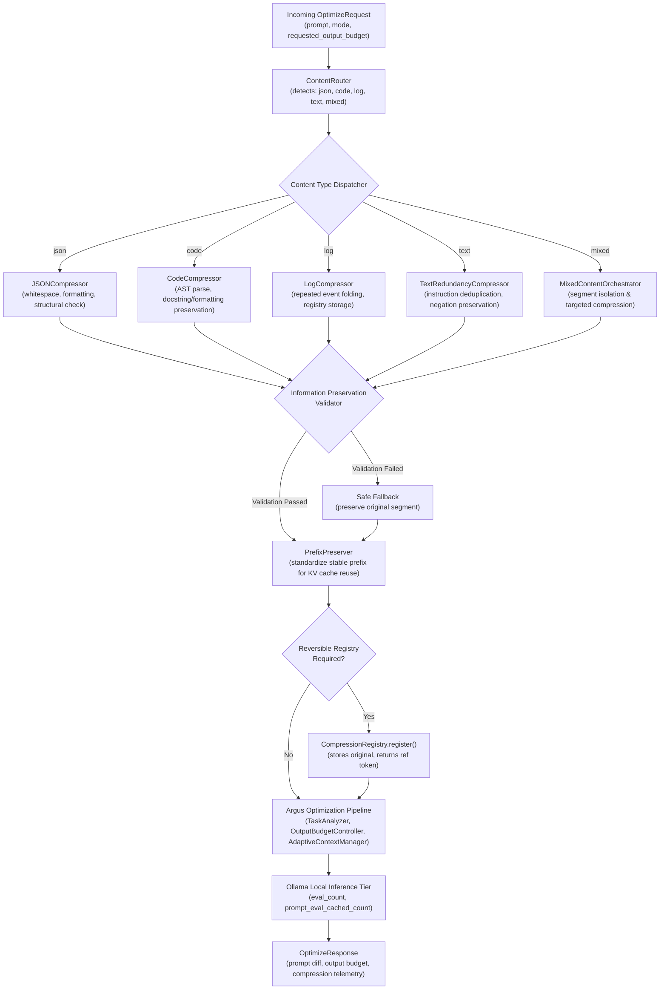

# Argus Phase 4.2 — Independent Content-Aware Compression Architecture

## 1. Architectural Purpose & Principles

The goal of the **Argus Content-Aware Compression Engine** is to safely reduce input prompt volume before model submission, maximizing effective KV-cache capacity, improving prompt processing latency, and preventing unnecessary context tier expansion—while strictly preserving all user intent, structural integrity, technical keywords, and operational constraints.

### Core Principles
1. **Information Preservation First**: Compression must never silently omit unique entities, numeric constraints, negative prohibitions, code execution semantics, or data structures.
2. **Deterministic Validation**: Every compression strategy is accompanied by an automated, programmatic validation step (AST parse comparison, JSON schema/equality check, token/constraint containment). If validation fails, the engine safely falls back to the original content.
3. **Independent Implementation**: An entirely original Argus architecture without external third-party proprietary dependencies or proxies.
4. **Reversibility**: For lossy structural reductions (e.g. omitted repeated log blocks), exact original content is preserved in a local original-content registry, enabling deterministic round-trip retrieval via cryptographic references.
5. **Coordination with Pipeline**: Operates seamlessly before KV-cache tier snapping (`AdaptiveContextManager`) and Output Budget Control (`OutputBudgetController`), reducing prompt token footprint so the context manager can snap to smaller physical context tiers while generation ceilings remain independently governed.

---

## 2. Pipeline Integration Flow



---

## 3. Component Specifications

### 3.1 ContentRouter (`backend/app/services/compression/router.py`)
Inspects input text and determines the primary content category and structure:
- **Detection Classes**:
  - `JSON`: Valid JSON payload or markdown JSON blocks (`{...}`, `[...]`).
  - `CODE`: Source code blocks in supported languages (Python, JavaScript/TypeScript, SQL, Shell, etc.).
  - `LOGS`: Timestamped log streams, stack traces, terminal execution outputs.
  - `TEXT`: Natural language prompts, instructions, conversation history.
  - `MIXED`: Multi-part prompts containing a blend of instructions and embedded code/JSON/log sections.
- **Classification Output**: Returns `ContentType`, confidence score ($0.0 \le c \le 1.0$), and isolated segments for mixed inputs.
- **Uncertainty Fallback**: If confidence $< 0.65$, routes as general text with conservative preservation.

### 3.2 JSONCompressor (`backend/app/services/compression/json_compressor.py`)
- **Transformation**: Strips superfluous indentation and formatting whitespace. Normalizes repeated structural keys where safe while preserving exact data types (strings, floats, ints, bools, nulls) and array element ordering.
- **Validation**: Compares `json.loads(original)` with `json.loads(compressed)`. The Python data structures must be structurally identical (`original_data == compressed_data`).
- **Safety**: If JSON parsing fails or structural difference is detected, returns original input unchanged.

### 3.3 CodeCompressor (`backend/app/services/compression/code_compressor.py`)
- **Transformation**:
  - *Python*: Parses via Python's standard `ast` module. Removes redundant inline comments and blank formatting while preserving docstrings, type annotations, and executable logic.
  - *Other languages*: Removes redundant comment blocks and safe whitespace without regex-only heuristic destruction.
- **Validation**:
  - Parses transformed code into AST; validates that function definitions, parameters, return statements, and class hierarchies remain structurally equivalent.
- **Safety**: If language parser is unavailable or syntax errors occur, preserves original code verbatim.

### 3.4 LogCompressor (`backend/app/services/compression/log_compressor.py`)
- **Transformation**: Detects repeated log entries (e.g. polling loops, heartbeat logs, recurring warnings). Compresses consecutive or cyclic identical events into concise summary markers:
  `[Repeated 24 times between 08:12:01 and 08:12:25: "Connection heartbeat ok"]`
- **Information Retained**: All unique error messages, severities (`FATAL`, `ERROR`, `WARN`), distinct error codes, first/last occurrences, and stack traces are preserved.
- **Reversibility**: If reversible compression is enabled, original repeated lines are stored in `CompressionRegistry`, returning a reference key embedded in the log output.

### 3.5 TextRedundancyCompressor (`backend/app/services/compression/text_compressor.py`)
- **Transformation**: Identifies duplicate adjacent or near-duplicate sentences, repetitive instruction preambles, and conversational filler.
- **Strict Preservations**:
  - Negations and prohibitions (`not`, `never`, `do not`, `prohibit`, `without`).
  - Specific technical terms, filenames, code symbols.
  - Numbers, dates, percentages, and currencies.
  - Formatting requests and deliverable specifications.
- **Validation**: Checks that every negative constraint, number, and key requirement present in the original is maintained in the compressed text.

### 3.6 PrefixPreserver (`backend/app/services/compression/prefix_preserver.py`)
- **Purpose**: Maximizes Ollama KV-cache reuse (`prompt_eval_cached_count`) by stabilizing prompt prefixes.
- **Mechanism**: Normalizes invariant prompt wrappers and separates variable dynamic inputs from static system instructions, ensuring identical prompt prefixes hit the cached KV buffer across multiple calls.
- **Telemetry**: Relies strictly on native Ollama `prompt_eval_cached_count` to measure cache hits.

### 3.7 CompressionRegistry (`backend/app/services/compression/registry.py`)
- **Storage**: In-memory registry storing original content with LRU eviction, TTL expiration (default 3600s), and memory bounds (max 1000 entries).
- **Reference Format**: `argus:ref:<sha256_prefix>`.
- **API**: Exposes lookup endpoint `GET /api/compression/registry/{ref_key}` to retrieve original content on demand.
- **Privacy & Logging**: Prevents logging sensitive payload bodies; logs only reference IDs and byte lengths.

### 3.8 CompressionOrchestrator (`backend/app/services/compression/orchestrator.py`)
- Serves as the single facade coordinating routing, compression, validation, telemetry tracking, and registry storage.
- Invoked seamlessly within `OllamaService.optimize_prompt()` prior to task analysis and budget allocation.

---

## 4. Telemetry Schema & Output Coordination

The compression engine returns a comprehensive telemetry object:
```json
{
  "enabled": true,
  "detected_content_type": "mixed",
  "confidence_score": 0.95,
  "strategy_applied": "code_and_json_structural",
  "original_tokens": 850,
  "compressed_tokens": 520,
  "tokens_reduced": 330,
  "compression_ratio": 0.612,
  "reduction_percent": 38.8,
  "token_measurement_method": "estimated_heuristic",
  "validation_status": "passed",
  "processing_time_ms": 14.2,
  "restoration_reference": "argus:ref:a7b8c9d0",
  "fallback_reason": null
}
```

This data flows to:
1. `AdaptiveContextManager`: Reduced token count allows snapping to smaller context tiers (e.g. 2048 instead of 4096), directly saving GPU VRAM.
2. `OutputBudgetController`: Output generation budget remains calculated based on task deliverable needs, unconstrained by bloated input.
3. `MetricsPanel.tsx`: Visualized in the React frontend with content badge, reduction stats, and restoration link.

