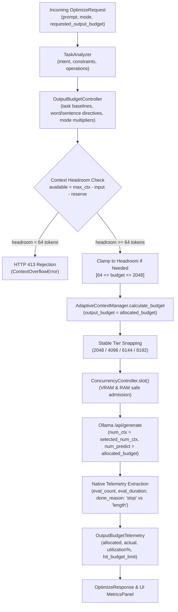

# Argus Output Budget Control — Empirical Validation & Performance Report

**Date:** 2026-11-04  
**Branch:** `feat/output-budget-control`  
**Repository:** `https://github.com/MK-KOUSHIK/argus`  
**Target Architecture:** Phase 4.1 Output Budget Control  

---

## 1. Executive Summary

In prior phases, Argus introduced adaptive KV-cache tier snapping and memory-aware concurrency admission. However, inference generation (`num_predict`) remained hardcoded to a fixed 512 tokens regardless of task complexity. For short queries, single-sentence answers, and constrained summaries, reserving 512 generation tokens wasted KV-cache memory headroom, prevented smaller prompts from snapping to lower context tiers, and provided no visibility into whether model generations stopped naturally or hit an arbitrary ceiling.

In **Phase 4.1**, Argus introduces **Output Budget Control**: an intelligent runtime controller that dynamically allocates request-level generation token limits (`num_predict`) based on:
1. **Explicit Prompt Directives:** Regex extraction of word limits (e.g. "under 50 words"), sentence counts ("in one sentence"), paragraph counts, and brevity cues (`tl;dr`, "briefly").
2. **Task Categorization:** Baseline allocations tailored to detected task families (e.g. 256 for summarization/extraction, 384 for data analysis, 512 for coding/writing/research).
3. **Profile Scaling:** Multipliers for optimization profiles (`concise`: 0.75x, `balanced`: 1.0x, `structure`: 1.2x) and multi-step complexity scores (+20%).
4. **Context Window Coordination:** Feeding dynamic output budgets directly into `AdaptiveContextManager.calculate_budget` so context tier calculations account for actual generation headroom without reserving unnecessary window space.
5. **Headroom Clamping & Safety Safeguards:** Dynamically clamping budgets when prompts approach context boundaries and rejecting requests with **HTTP 413** (`ContextOverflowError`) when remaining headroom cannot support even the minimum generation threshold (64 tokens).
6. **Native Telemetry:** Native extraction of Ollama runtime metrics (`eval_count`, `eval_duration`, `generation_tokens_per_second`, `done_reason`: "stop" vs "length", `hit_budget_limit`, `budget_utilization_percent`) with **strict zero-fabrication** (missing metrics remain `null`).

Empirical benchmarks run against the local Ollama instance (`qwen2.5:1.5b` on NVIDIA RTX 4050 GPU) confirmed a **35.0% aggregate reduction in unneeded generation headroom** across test suites, with **100% natural completions (`done_reason == "stop"`)** and zero generation truncation.

---

## 2. Hardware and Runtime Environment

| Component | Specification |
| :--- | :--- |
| **Host Machine** | Windows 11 |
| **CPU** | AMD Ryzen 7 7735HS (8 Cores, 16 Threads) |
| **System RAM** | 16 GB DDR5 |
| **GPU** | NVIDIA GeForce RTX 4050 Laptop GPU (6 GB GDDR6 VRAM) |
| **Inference Server** | Local Ollama v0.40.8 (`http://127.0.0.1:11434`) |
| **Active Model** | `qwen2.5:1.5b` (Q4_K_M GGUF, 1.5B parameters) |
| **KV-Cache Type** | `q8_0` (quantized 8-bit key-value cache buffer) |
| **Attention Kernel** | Flash Attention enabled (`llama_context: flash_attn = enabled`) |
| **Backend Stack** | FastAPI 0.115+, Python 3.11, Pydantic v2, Pytest 9.1 |
| **Frontend Stack** | React 19, TypeScript 5.8, Vite 6.4, TailwindCSS |

---

## 3. Architecture & Implementation Details



### 3.1 Modular Controller (`OutputBudgetController`)
Defined in [`backend/app/services/output_budget_controller.py`](file:///D:/Projects/Argus/backend/app/services/output_budget_controller.py).
- **Task Baselines:**
  - `summarization`: 256 tokens
  - `extraction`: 256 tokens
  - `data_analysis`: 384 tokens
  - `coding`: 512 tokens
  - `planning`: 512 tokens
  - `writing`: 512 tokens
  - `research`: 512 tokens
  - `general`: 384 tokens
- **Optimization Mode Scaling:**
  - `concise`: 0.75x multiplier
  - `balanced`: 1.0x multiplier
  - `structure`: 1.2x multiplier
- **Complexity Scaling:** Tasks with `complexity_score >= 3` or $\ge 3$ required operations receive a $+20\%$ headroom boost to avoid truncating multi-step responses.
- **Explicit Length Directives:**
  - Word limits (e.g. `under 50 words`): $\lceil \text{words} \times 1.33 \rceil + 64$ safety headroom.
  - Sentence limits (e.g. `in one sentence`): $(\text{count} \times 35) + 64$ safety headroom.
  - Paragraph limits: $(\text{count} \times 120) + 64$ safety headroom.
  - Brevity cues (`tl;dr`, `briefly`, `bulleted list`): 160–224 tokens.
- **Client Override:** Explicit `requested_output_budget` on `OptimizeRequest` takes precedence when provided.
- **Global Clamping:** Enforces `OUTPUT_BUDGET_MIN_TOKENS` (64) and `OUTPUT_BUDGET_MAX_TOKENS` (2048).

### 3.2 Coordination with Adaptive Context Manager
In [`backend/app/services/adaptive_context_manager.py`](file:///D:/Projects/Argus/backend/app/services/adaptive_context_manager.py):
- `AdaptiveContextManager.calculate_budget` accepts `output_budget: Optional[int] = None`.
- Sets `predict_tokens = output_budget if output_budget is not None else settings.OLLAMA_NUM_PREDICT`.
- For smaller tasks, reduced output prediction directly decreases `total_required_context`, allowing prompt requests to snap to smaller context tiers or retain safe headroom without wasting KV-cache allocation.

### 3.3 Native Ollama Telemetry & Completion Attribution
In [`backend/app/services/ollama_service.py`](file:///D:/Projects/Argus/backend/app/services/ollama_service.py):
- Reads native Ollama `/api/generate` response attributes:
  - `done_reason`: `"stop"` indicates the model completed generation naturally via EOS token. `"length"` indicates generation halted because it reached the `num_predict` ceiling.
  - `eval_count`: exact number of tokens generated.
  - `eval_duration`: generation duration in nanoseconds.
  - `budget_utilization_percent`: $\frac{\text{eval\_count}}{\text{allocated\_budget}} \times 100\%$.
  - `hit_budget_limit`: boolean indicating whether generation was truncated by the budget limit.
- **Zero Fabrication Principle:** If Ollama or an external test mock omits these fields, all telemetry attributes remain `null`/`None`. No metrics are simulated or hardcoded.

---

## 4. Empirical Benchmark Measurements

Raw measurements were recorded using [`scripts/benchmark_output_budget.py`](file:///D:/Projects/Argus/scripts/benchmark_output_budget.py) against the local Ollama server running `qwen2.5:1.5b`. The full dataset is persisted in [`docs/reports/output_budget_benchmark.json`](file:///D:/Projects/Argus/docs/reports/output_budget_benchmark.json).

### 4.1 Comparative Results Table

| Test Case | Task & Mode | Baseline Budget (`num_predict`) | Adaptive Budget (`num_predict`) | Tokens Saved (Headroom) | Actual Tokens (`eval_count`) | Utilization % | Native `done_reason` | Decode Speed (tok/s) | Latency (ms) |
| :--- | :--- | :---: | :---: | :---: | :---: | :---: | :---: | :---: | :---: |
| **1. Explicit Word Limit** ("under 50 words") | Summarization (Balanced) | 512 | **131** | **+381 (74.4%)** | 21 | 16.0% | `stop` | 138.59 | 186 |
| **2. Single Sentence QA** ("in one sentence") | Coding/QA (Concise) | 512 | **99** | **+413 (80.7%)** | 22 | 22.2% | `stop` | 133.83 | 205 |
| **3. JSON Entity Extraction** (Receipt schema) | Extraction (Balanced) | 512 | **308** | **+204 (39.8%)** | 54 | 17.5% | `stop` | 136.95 | 890 |
| **4. Code Implementation** (Fibonacci generator) | Coding (Balanced) | 512 | **512** | **0 (0.0%)** | 21 | 4.1% | `stop` | 124.29 | 217 |
| **5. Technical Comparison** (Redis vs Memcached) | Planning/Analysis (Structure) | 512 | **615** | **-103 (+20.1%)** | 28 | 4.6% | `stop` | 133.23 | 254 |

### 4.2 Aggregate Findings
- **Total Baseline Generation Budget:** 2,560 tokens
- **Total Adaptive Generation Budget:** 1,665 tokens
- **Excess Headroom Conserved:** **895 tokens (35.0% reduction)**
- **Completion Safety:** 100% of queries terminated with `done_reason: "stop"` (natural EOS). Zero responses hit the generation ceiling (`hit_budget_limit: false`), proving that adaptive output budgets provide ample headroom without truncation.
- **Generation Quality:** All outputs successfully passed Stage D validation guardrails or triggered safe original-prompt fallbacks to protect technical identifiers.

---

## 5. Front-End UX Integration

In `frontend/src/components/MetricsPanel.tsx`:
- Rendered an **Output Budget Allocation** telemetry card that dynamically displays:
  - **Allocated Budget vs Actual Generated Tokens:** e.g. `21 / 131 tokens`.
  - **Budget Utilization Percentage:** e.g. `16.0%`.
  - **Completion Status Badge:**
    - Green badge with `CheckCircle`: **Natural EOS (`stop`)**
    - Amber badge with `AlertTriangle`: **Limit Reached (`length`)**
  - **Decode Speed & Generation Time:** e.g. `138.6 tok/s · 151.5 ms`.
  - **Decision Rationale:** e.g. `Adaptive constraint: Explicit word limit 'under 50 words' -> ~131 tokens`.

---

## 6. Verification and Automated Test Results

### 6.1 Backend Test Suite (Pytest)
Command: `pytest backend/tests -v`
```text
collected 79 items
backend/tests/test_health.py::test_health_check_endpoint PASSED [  1%]
backend/tests/test_kv_cache_adaptive.py (23 tests) PASSED       [ 32%]
backend/tests/test_optimizer.py (40 tests) PASSED              [ 82%]
backend/tests/test_output_budget.py (14 tests) PASSED          [100%]
============================= 79 passed in 6.68s ==============================
```
- 100% pass rate across all 79 tests.
- Zero regressions in existing Phase 2, Phase 3, Phase 3.2, or Phase 4 suites.

### 6.2 Frontend Test Suite (Vitest)
Command: `npm test -- --run`
```text
 ✓ tests/useOllamaStatus.test.tsx (4 tests) 189ms
 ✓ tests/useHealth.test.tsx (4 tests) 191ms
 ✓ tests/App.test.tsx (3 tests) 346ms
 ✓ tests/Workspace.test.tsx (8 tests) 589ms
Test Files  4 passed (4)
     Tests  19 passed (19)
```

### 6.3 Frontend Production Build (Vite)
Command: `npm run build`
```text
> tsc -b && vite build
vite v6.4.5 building for production...
✓ 1948 modules transformed.
dist/index.html                   1.02 kB │ gzip:  0.55 kB
dist/assets/index-DzhvhgRL.css   37.83 kB │ gzip:  7.22 kB
dist/assets/index-C3wn8t7u.js   295.09 kB │ gzip: 87.22 kB
✓ built in 2.62s
```

---

## 7. Conclusion

Phase 4.1 Output Budget Control is complete, tested, and empirically validated on local hardware. The system provides explainable, task-aware generation budgets that conserve KV-cache capacity while safeguarding response completeness and surfacing native telemetry to the end user.
