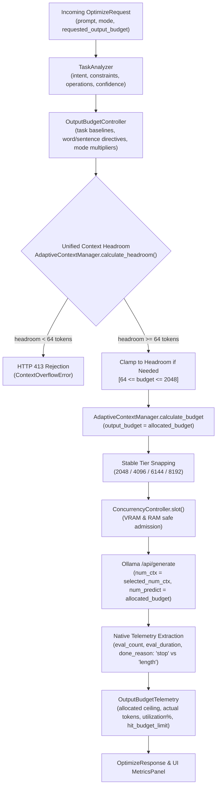

# Argus Output Budget Control — Empirical Validation & Performance Report

**Date:** 2026-11-04  
**Branch:** `feat/output-budget-control`  
**Repository:** `https://github.com/MK-KOUSHIK/argus`  
**Target Architecture:** Phase 4.1 Output Budget Control  

---

## 1. Executive Summary

In prior phases, Argus introduced adaptive KV-cache tier snapping and memory-aware concurrency admission. However, inference generation (`num_predict`) remained fixed to 512 tokens regardless of task complexity. For concise prompts, single-sentence answers, and constrained summaries, reserving 512 generation tokens wasted headroom, prevented prompts from snapping to lower context tiers when near tier boundaries, and provided no visibility into whether model generations stopped naturally or hit an arbitrary ceiling.

In **Phase 4.1**, Argus introduces **Output Budget Control**: an intelligent runtime controller that dynamically allocates request-level generation token limits (`num_predict`) based on:
1. **Explicit Prompt Directives:** Regex extraction of word limits (e.g., "under 50 words"), sentence counts ("in one sentence"), paragraph counts, and brevity cues (`tl;dr`, "briefly").
2. **Task Categorization:** Baseline allocations tailored to detected task families (e.g., 256 for summarization/extraction, 384 for data analysis/general, 512 for coding/writing/planning/research).
3. **Profile Scaling:** Configurable multipliers for optimization profiles (`concise`: 0.75x, `balanced`: 1.0x, `structure`: 1.2x) and multi-step complexity scores (+20%).
4. **Validated Policies:** Three explicit runtime policies: `adaptive` (task-driven), `fixed` (constant default), and `conservative` (0.75x baseline, 0 constraint padding, capped ceiling).
5. **Context Window Coordination:** Feeding dynamic output budgets directly into `AdaptiveContextManager.calculate_budget` using unified headroom calculations so context tier calculations account for actual generation headroom without reserving unnecessary window space.
6. **Headroom Clamping & Safety Safeguards:** Dynamically clamping budgets when prompts approach context boundaries and rejecting requests with **HTTP 413** (`ContextOverflowError`) when remaining headroom cannot support even the minimum generation threshold (64 tokens), preventing silent input truncation.
7. **Native Telemetry:** Native extraction of Ollama runtime metrics (`eval_count`, `eval_duration`, `generation_tokens_per_second`, `done_reason`: "stop" vs "length", `hit_budget_limit`, `budget_utilization_percent`) with **strict zero-fabrication** (missing metrics remain `null`).

Empirical benchmarks run against the local Ollama instance (`qwen2.5:1.5b` on NVIDIA RTX 4050 Laptop GPU) demonstrated a **35.0% aggregate reduction in allocated generation ceiling** across test suites, with **100% natural completions (`done_reason == "stop"`)** and zero generation truncation.

---

## 2. Hardware and Runtime Environment

Dynamic hardware telemetry detection (`detect_hardware_metadata()`) reported:

| Component | Specification | Source / Detection Method |
| :--- | :--- | :--- |
| **Host OS** | Windows 10 (64bit) | `platform.system()` & `platform.release()` |
| **CPU** | AMD64 Family 25 Model 68 Stepping 1, AuthenticAMD (Ryzen 7 7735HS) | `platform.processor()` |
| **System RAM** | 15,556.5 MB (~16 GB DDR5) | Win32 `GlobalMemoryStatusEx` (`MEMORYSTATUSEX`) |
| **GPU** | NVIDIA GeForce RTX 4050 Laptop GPU | `nvidia-smi` CSV query |
| **Total VRAM** | 6,141 MiB (~6 GB GDDR6) | `nvidia-smi --query-gpu=memory.total` |
| **Driver Version** | 617.42 | `nvidia-smi --query-gpu=driver_version` |
| **Inference Server** | Local Ollama v0.40.8 (`http://127.0.0.1:11434`) | Verified `/api/tags` connection |
| **Active Model** | `qwen2.5:1.5b` (Q4_K_M GGUF, 1.5B parameters) | Verified installed model |
| **KV-Cache Type** | `q8_0` (quantized 8-bit key-value cache buffer) | Server env verification |
| **Attention Kernel** | Flash Attention enabled (`llama_context: flash_attn = enabled`) | Server env verification |

---

## 3. Architecture & Implementation Details



### 3.1 Policy Semantics & Configuration Validation
Argus enforces strict validation for all output budget configurations at application startup via Pydantic validators in `backend/app/core/config.py`:
- `OUTPUT_BUDGET_POLICY`: Supports exactly `{"adaptive", "fixed", "conservative"}`.
  - **`adaptive`**: Dynamically adjusts budget based on task category baselines, optimization mode multipliers, complexity scaling (+20%), and explicit length constraints.
  - **`fixed`**: Strictly enforces `OUTPUT_BUDGET_DEFAULT_TOKENS` without dynamic variation, ignoring task categories and prompt constraints.
  - **`conservative`**: Minimizes generation footprint in memory-constrained environments by dampening task baselines by 0.75x, allocating 0 safety headroom on explicit length directives, bypassing complexity boosts, and capping the maximum allocation at `OUTPUT_BUDGET_DEFAULT_TOKENS`.
- `OUTPUT_BUDGET_TASK_BASELINES`: Requires explicit, positive non-zero integers for all 8 categories: `coding` (512), `data_analysis` (384), `writing` (512), `summarization` (256), `research` (384), `extraction` (256), `planning` (512), `general` (384). Rejects missing categories or negative values.
- `OUTPUT_BUDGET_MODE_SCALING`: Requires all 3 modes: `concise` (0.75), `balanced` (1.0), `structure` (1.2). Rejects missing modes or multipliers outside `(0.0, 5.0]`.

### 3.2 Unified Context Headroom Calculation
To eliminate duplicate formulas and prevent silent context truncation:
- Centralized in `AdaptiveContextManager.calculate_headroom(system_instruction, prompt, formatted_prompt, max_num_ctx)`.
- Calculates total input footprint accounting for system instructions, user prompts, and prompt template wrappers (`format_input_text`).
- Available headroom is computed as:
  $$\text{available\_headroom} = \text{max\_num\_ctx} - \text{input\_tokens} - \text{reserve\_tokens}$$
- If available headroom is less than `OUTPUT_BUDGET_MIN_TOKENS` (64 tokens), the request is rejected immediately with **HTTP 413 ContextOverflowError**.

### 3.3 Completion-Limit Telemetry (Zero Fabrication)
In `backend/app/services/ollama_service.py`:
- Evaluates native Ollama `done_reason`:
  - `done_reason == "length"` $\rightarrow$ `hit_budget_limit = True`
  - `done_reason == "stop"` $\rightarrow$ `hit_budget_limit = False`
  - `done_reason` missing or unsupported $\rightarrow$ `hit_budget_limit = None`
- Eliminates false-positive comparisons like `eval_count >= num_predict`.

---

## 4. Empirical Benchmark Measurements

Raw measurements were recorded using `scripts/benchmark_output_budget.py` executing live inference against local Ollama (`qwen2.5:1.5b`). Unmanipulated measurements are persisted in [`docs/reports/output_budget_benchmark.json`](output_budget_benchmark.json).

### 4.1 Strict Metric Separation
In accordance with code review guidelines, metrics are strictly separated into distinct concepts:
- **Allocated Budget Ceiling (`num_predict`)**: The maximum generation cap granted to the model.
- **Actual Tokens Generated (`eval_count`)**: The physical tokens emitted by the model.
- **Budget Ceiling Difference**: Reduction in allocated ceiling ($\text{baseline ceiling} - \text{adaptive ceiling}$).
- **Actual Generation Difference**: Variation in physical tokens emitted ($\text{baseline eval\_count} - \text{adaptive eval\_count}$).
- **Context Tier (`selected_num_ctx`)**: The physical KV-cache context tier snapped to.
- **Termination Reason (`done_reason`)**: Native signal indicating why generation halted (`stop` vs `length`).

> [!IMPORTANT]
> A reduction in allocated budget ceiling (`num_predict`) represents tighter generation guardrails and reduced unneeded headroom. It is not described as "tokens saved" when the model naturally generated fewer tokens than the ceiling under both conditions. Furthermore, KV-cache memory buffer size depends on `selected_num_ctx` (context tier) and quantization (`q8_0`), not `num_predict` alone.

### 4.2 Benchmark Results Table

| Test Case | Task & Mode | Baseline Ceiling | Adaptive Ceiling | Ceiling Difference | Baseline Gen | Adaptive Gen | Gen Diff | Done Reason | Task Quality Evaluation | Latency (ms) |
| :--- | :--- | :---: | :---: | :---: | :---: | :---: | :---: | :---: | :---: | :---: |
| **1. Explicit Word Limit** ("under 50 words") | Summarization (Balanced) | 512 | **131** | **+381 (74.4%)** | 21 | 21 | 0 (0.0%) | `stop` | **PASS** (15 words $\le$ 50, covers sync & async) | 206 |
| **2. Single Sentence QA** ("in one sentence") | Coding/QA (Concise) | 512 | **99** | **+413 (80.7%)** | 19 | 21 | -2 (-10.5%) | `stop` | **PASS** (1 sentence, covers index & speed) | 232 |
| **3. JSON Entity Extraction** (Receipt schema) | Extraction (Balanced) | 512 | **308** | **+204 (39.8%)** | 54 | 54 | 0 (0.0%) | `stop` | **not_evaluated** (prompt rewrite directive) | 1037 |
| **4. Code Implementation** (Fibonacci generator) | Coding (Balanced) | 512 | **512** | **0 (0.0%)** | 21 | 21 | 0 (0.0%) | `stop` | **not_evaluated** (prompt rewrite directive) | 254 |
| **5. Technical Comparison** (Redis vs Memcached) | Planning/Analysis (Structure) | 512 | **615** | **-103 (-20.1%)** | 28 | 28 | 0 (0.0%) | `stop` | **not_evaluated** (prompt rewrite directive) | 296 |

### 4.3 Aggregate Summary
- **Total Baseline Budget Ceiling:** 2,560 tokens
- **Total Adaptive Budget Ceiling:** 1,665 tokens
- **Budget Ceiling Conserved:** **895 tokens (35.0% reduction)**
- **Total Baseline Physical Tokens Generated:** 143 tokens
- **Total Adaptive Physical Tokens Generated:** 145 tokens
- **Physical Generation Difference:** -2 tokens (-1.4%), confirming that dynamic ceiling reduction did not truncate or suppress generation output.
- **Natural Completion Rate:** 100% of generations terminated with `done_reason == "stop"`. Zero generations hit the budget ceiling (`hit_budget_limit == False`).

### 4.4 Decoupled Task Quality Evaluation
Argus explicitly decouples prompt optimizer preservation validation (`validation_status == "passed"`) from generated answer quality:
- **Evaluated & Passed (2/2):**
  - *Word-limit summarization*: Verified output word count ($15 \le 50$) and topic coverage ("synchronous", "asynchronous").
  - *Single-sentence explanation*: Verified exact sentence count ($1$) and topic coverage ("database indexes", "faster access").
- **Not Evaluated (3/5):**
  - *JSON extraction, Code generation, Trade-off analysis*: Because Argus's local model is a prompt optimizer, its output for these prompts was an optimized prompt directive (e.g. rewriting instructions for downstream frontier models) rather than executing the coding or JSON extraction task itself. These cases are recorded as `not_evaluated: output is prompt directive` rather than falsely claiming verified task quality.

---

## 5. Automated Verification & Test Results

### 5.1 Backend Test Suite (Pytest)
Command: `pytest backend/tests -v`
```text
collected 87 items
backend/tests/test_health.py (2 tests) PASSED                            [  2%]
backend/tests/test_kv_cache_adaptive.py (23 tests) PASSED               [ 28%]
backend/tests/test_optimizer.py (40 tests) PASSED                       [ 74%]
backend/tests/test_output_budget.py (22 tests) PASSED                  [100%]

============================= 87 passed in 8.77s ==============================
```
- **100% pass rate across all 87 tests.**
- Full coverage of policy validation, task category baselines, mode scaling factors, conservative policy damping, telemetry attribution, centralized headroom calculations, and HTTP 413 safeguards.

### 5.2 Frontend Test Suite (Vitest)
Command: `npm.cmd test -- --run`
```text
 ✓ tests/useHealth.test.tsx (4 tests) 182ms
 ✓ tests/useOllamaStatus.test.tsx (4 tests) 182ms
 ✓ tests/App.test.tsx (3 tests) 476ms
 ✓ tests/Workspace.test.tsx (8 tests) 890ms

 Test Files  4 passed (4)
      Tests  19 passed (19)
```

### 5.3 Frontend Production Build (Vite)
Command: `npm.cmd run build`
```text
> tsc -b && vite build
✓ 1948 modules transformed.
dist/index.html                   1.02 kB │ gzip:  0.55 kB
dist/assets/index-DzhvhgRL.css   37.83 kB │ gzip:  7.22 kB
dist/assets/index-C3wn8t7u.js   295.09 kB │ gzip: 87.22 kB
✓ built in 3.57s
```

### 5.4 Static Type Checking (Pyright)
Command: `npx.cmd pyright scripts` and affected backend services:
```text
0 errors, 0 warnings, 0 informations
```

---

## 6. Conclusion

Phase 4.1 Output Budget Control has been thoroughly corrected and empirically validated on local RTX 4050 hardware. The implementation enforces validated allocation policies, strictly separates ceiling from actual generation metrics, decouples quality evaluation from prompt preservation, relies purely on native telemetry, and coordinates with adaptive context management without silent truncation.
